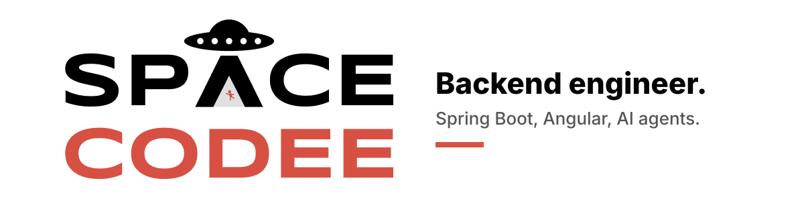

<picture>
  <source media="(prefers-color-scheme: dark)" srcset="assets/banner-dark.svg">
  
</picture>

Backend engineer from Perú. I build with Spring Boot and Hexagonal Architecture, ship Angular frontends, and wire AI coding agents into real workflows.

If you can imagine it, you can program it.

## Stack

<picture>
  <source media="(prefers-color-scheme: dark)" srcset="https://skillicons.dev/icons?i=java,spring,postgres,angular,ts,tailwind,go,py,cpp,dart,docker,neovim&perline=12&theme=dark">
  
</picture>

## Featured

**[springboot-security-open-template](https://github.com/spacecodee/springboot-security-open-template)**
A Spring Boot template for JWT authentication and role-based access control, with secure user management, token protections and Swagger/OpenAPI docs.

**[security-spacee](https://github.com/spacecodee/security-spacee)**
Java 25 and Spring Boot 4 enterprise application built with Hexagonal Architecture and Vertical Slicing.

**[spacee-herdr-bridge](https://github.com/spacecodee/spacee-herdr-bridge)** and **[spacee-herdr-frontend](https://github.com/spacecodee/spacee-herdr-frontend)**
Run your terminals and coding agents (Claude Code, Codex, opencode, pi) from your phone. A small Go server and an installable Angular PWA over Tailscale.

**[inventory-to-csv](https://github.com/spacecodee/inventory-to-csv)**
Extracts product data from photos with Google Gemini. Angular 21, Supabase and Tailwind CSS 4.

## Activity

<picture>
  <source media="(prefers-color-scheme: dark)" srcset="https://streak-stats.demolab.com/?user=spacecodee&hide_border=true&background=0B1020&ring=2DD4BF&fire=2DD4BF&currStreakLabel=2DD4BF&sideLabels=E6EDF3&currStreakNum=E6EDF3&sideNums=E6EDF3&dates=9AA7BD">
  
</picture>

## Tools and experiments

- [software-development-tools](https://github.com/spacecodee/software-development-tools): local PostgreSQL, SonarQube and Mailpit via Docker, with MCP support for AI-assisted development.
- [ai-driven-fullstack-template](https://github.com/spacecodee/ai-driven-fullstack-template): a full-stack Git superproject with frontend and backend submodules, Spring Modulith and written-down conventions for AI agents.
- [acestep-compose-docker](https://github.com/spacecodee/acestep-compose-docker): Docker Compose deployment of the ACE-Step 1.5 music generation model with GPU support.
- [music-download-manager](https://github.com/spacecodee/music-download-manager): a yt-dlp CLI with an interactive terminal UI.
- [Esp32FireTruckDev](https://github.com/spacecodee/Esp32FireTruckDev) and [ESP32FireTruckWebIoT](https://github.com/spacecodee/ESP32FireTruckWebIoT): a remote-controlled fire truck on an ESP32, driven over WebSocket from an Angular control panel.
- [neural-convolutional-red-lemon](https://github.com/spacecodee/neural-convolutional-red-lemon): a convolutional network that detects foliar diseases in lemon leaves.

## Learning

AI engineering: agents, MCP, and the tooling around them. Open to collaborating on anything that mixes AI and backend.
